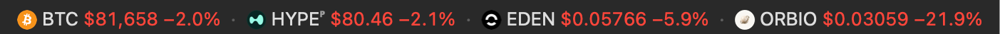
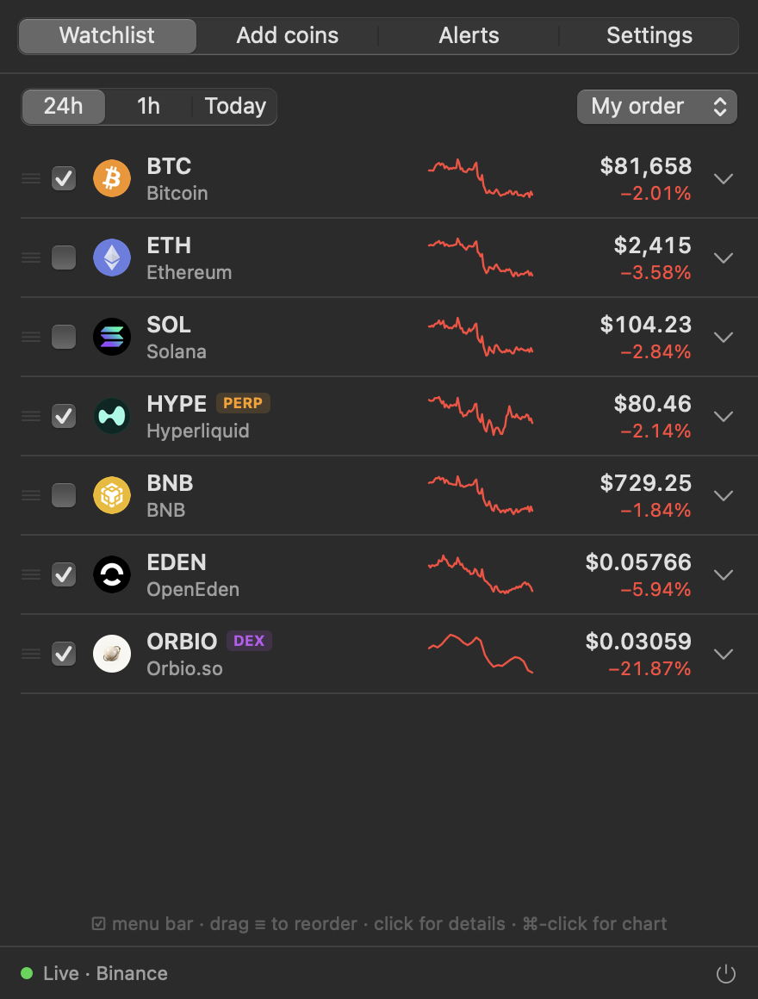
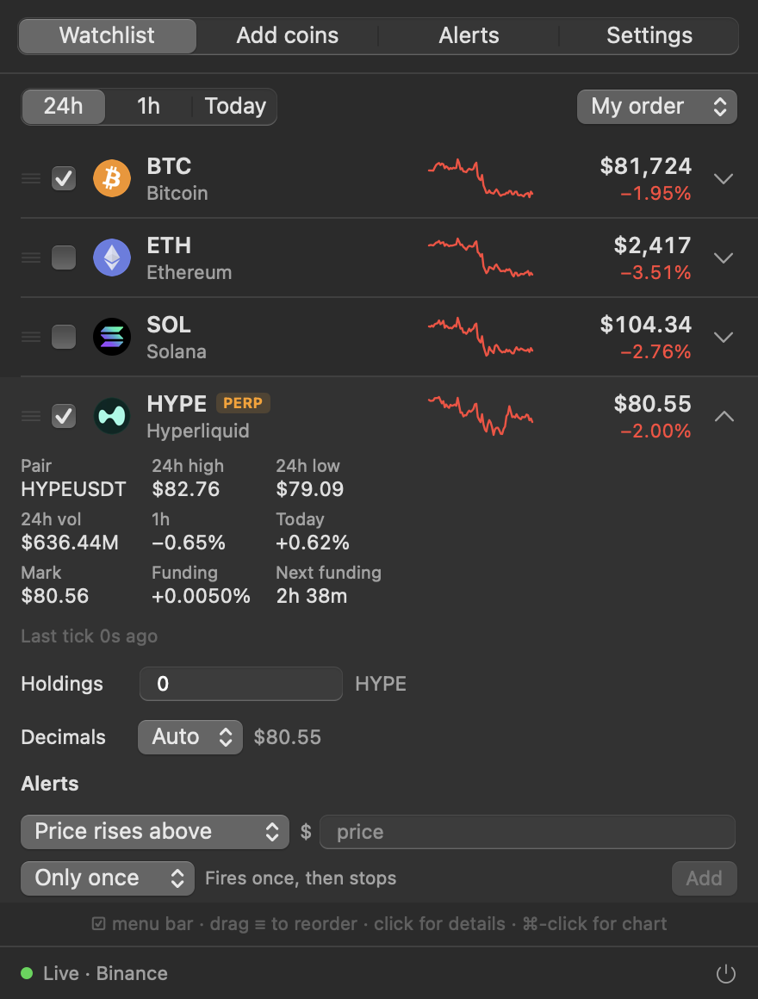
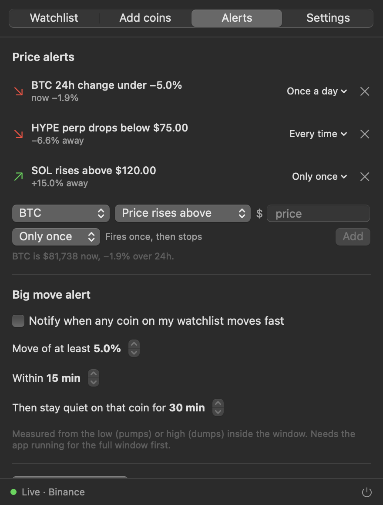

# TickBar

Live crypto prices in your macOS menu bar.



Most menu bar tickers poll an aggregator like CoinGecko and run a minute or two behind the market. TickBar streams prices straight from Binance over WebSocket, so the menu bar updates about once a second. DEX tokens on any chain are supported too, via DexScreener.

<p>
  
  
  
</p>

## Features

**Prices**
- Every Binance spot market and USD-M perpetual (1,000+ coins), streamed live
- DEX tokens on any chain: paste a contract address or search by name (refreshes every ~6s)
- Show prices in USD, SGD or EUR, quoted against USDT, USDC or FDUSD
- Percent change over 24h, 1h or since midnight
- Connection status always visible: a warning appears in the menu bar if data goes stale, so old prices never pass for live ones

**Menu bar**
- Pick which coins appear, with logo, symbol, price and % change in any combination
- Color by % change or by the last tick, with an optional green/red flash on every tick
- Compact numbers (83.3k), per-coin decimal places, system or monospaced font
- Rotate through a long list a few coins at a time
- Optional total value of your holdings

**Watchlist**
- 24h sparklines, drag to reorder, sort by % change or volume
- Click a coin for details: 24h high/low, volume, and mark price, funding rate and countdown for perps; pool, exchange and liquidity for DEX tokens
- Track holdings per coin
- ⌘-click opens the chart on Binance, TradingView or DexScreener

**Alerts** (macOS notifications)
- Price rises above / drops below a level
- 24h change goes over / under a percentage
- Fire only once, at most once a day, or every time the line is crossed (with a 0.5% reset so a price hovering at your line doesn't spam you)
- Big-move alert: any watched coin moving X% within Y minutes

## Install

1. Download `TickBar.zip` from the [latest release](../../releases/latest), unzip it and drag **TickBar** into **Applications**.
2. Double-click TickBar. macOS will say *"Apple could not verify TickBar is free of malware"*. Click **Done** (not Move to Trash).
3. Open **System Settings → Privacy & Security** and scroll down to the **Security** section. You'll see *"TickBar was blocked to protect your Mac"*. Click **Open Anyway**.
4. Confirm with your Mac password or Touch ID, then click **Open Anyway** once more. TickBar appears in your menu bar.

You only need to do this once per version. After that, TickBar opens normally.

Prefer Terminal? This does steps 2 to 4 in one go:

```sh
xattr -dr com.apple.quarantine /Applications/TickBar.app
```

### Why the warning?

TickBar is a free, open-source side project. macOS shows this warning for any app that isn't signed through Apple's paid developer program, which costs US$99 a year. The warning means Apple hasn't reviewed the app. It doesn't mean anything was found wrong with it.

Since every line of TickBar's code is public, you don't have to take that on trust:

- **Read the code.** It's all in [`Sources/TickBar`](Sources/TickBar), about 2,500 lines of Swift.
- **Check what it connects to.** Only the public market-data services listed under [Data sources](#data-sources). There's no account, no tracking and no server of its own.
- **Build it yourself.** Follow [Build from source](#build-from-source) and run an app you compiled from the code you just read.

To move TickBar in the menu bar, hold **⌘** and drag it. To start it automatically, turn on **Launch at login** in Settings.

**Requirements:** macOS 14 (Sonoma) or newer, on Apple silicon or Intel.

**Note:** Binance blocks connections from the United States, so Binance prices won't load from US IP addresses. DEX tokens still work.

## Privacy

TickBar has no account, no server and no analytics. It only reads public market data from Binance, DexScreener, GeckoTerminal and a public FX-rate feed. Your watchlist, holdings and alerts are stored on your Mac and never leave it.

Alerts run on your Mac too, so they only fire while TickBar is running.

## Build from source

Needs the Xcode Command Line Tools (`xcode-select --install`). Full Xcode isn't required.

```sh
git clone https://github.com/jojosomecrypt/tickbar.git
cd tickbar
swift run                 # run a dev build
scripts/build_app.sh      # build dist/TickBar.app (universal) and dist/TickBar.zip
```

To sign and notarize with an Apple Developer ID so the app opens without the security prompt:

```sh
xcrun notarytool store-credentials tickbar \
  --apple-id you@example.com --team-id TEAMID

SIGN_IDENTITY="Developer ID Application: Your Name (TEAMID)" \
NOTARY_PROFILE=tickbar \
scripts/build_app.sh
```

## Data sources

| What | Source |
|---|---|
| Spot and perp prices | Binance WebSocket streams (`stream.binance.com`, `fstream.binance.com`) |
| Market list, 24h stats, candles, funding | Binance REST API |
| Coin names and logos | Binance asset listing |
| DEX token prices and pools | DexScreener API |
| DEX 24h candles | GeckoTerminal API, with TickBar's own price history as a fallback |
| SGD / EUR conversion | open.er-api.com, refreshed hourly |

TickBar is not affiliated with Binance, DexScreener or GeckoTerminal. Prices are for information only and not financial advice.

## License

[MIT](LICENSE). Free to use, modify and share.
